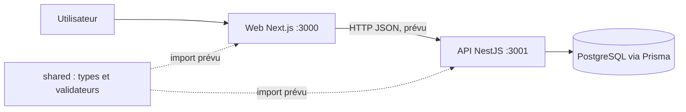
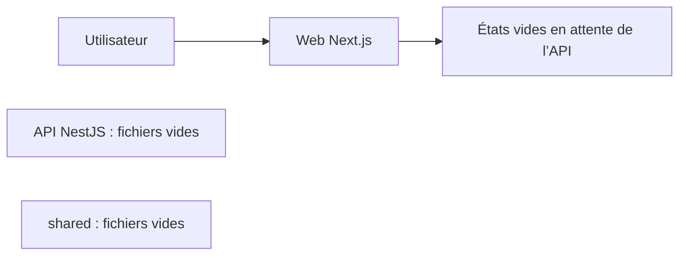

# Architecture PharmaOS

## Résumé

PharmaOS vise une application web connectée à une API métier NestJS, à PostgreSQL via Prisma et à un package de contrats partagés TypeScript/Zod. L’architecture cible est multi-tenant et multi-pharmacies.

Les traits pointillés signalent une intégration attendue, pas une intégration en place.

L’API NestJS écoute sur `:3001`. `PrismaService` est la porte d’accès à PostgreSQL. L’identité JWT contient `sub`, `tenantId`, `pharmacyId` et `role`; le `AuthGuard` la place dans `request.user`. Les cookies HttpOnly sont utilisés par le web.

## État réellement implémenté

Le frontend et le socle API sont configurés. `api/prisma/schema.prisma` contient les modèles `Tenant`, `Pharmacy` et `User` avec rôles `OWNER`, `MANAGER`, `CASHIER`; `api/prisma/seed.ts` fournit un compte local rejouable. Les migrations sont générées localement par Prisma après disponibilité de PostgreSQL. Les modules métier restent indépendants de ce socle.

## Frontend

- Framework : Next.js 15 App Router, React 19, TypeScript.
- Entrée du dashboard : `web/app/(dashboard)/page.tsx`, servie à `/`.
- Layout commun : `web/app/(dashboard)/layout.tsx` et `web/components/dashboard-shell.tsx`.
- Pages authentification : `web/app/(auth)/login/page.tsx` et `register/page.tsx`.
- Liste et formulaire produit : `web/components/products-page.tsx`.
- Styles : `web/app/styles.css`.
- Icônes : SVG internes dans `web/components/icons.tsx`.
- Logo de marque : `web/public/pharmaos-logo.png`, avec transparence, utilisé dans la navigation et les pages d’authentification.
- Aucun jeu de données métier n’est chargé. Le dashboard, l’annuaire fournisseurs, la sélection de pharmacies et les autres modules affichent des états vides.
- Les formulaires d’ajout de produit et de fournisseur ne conservent les éléments qu’en mémoire jusqu’au rechargement.
- Login/register sont des écrans de formulaire sans endpoint ; « Se déconnecter » nettoie les clés locales de jeton prévues et redirige vers `/login`. Aucun jeton/session serveur n’est actuellement délivré.

Le menu de pharmacie est vide jusqu’au branchement des données pharmacies. La propagation du site actif au client API reste à implémenter.

## API et persistance prévues

Les répertoires `api/src/modules/` contiennent les emplacements métier. `auth` et `users` sont implémentés ; les autres modules attendent leurs contrats et services respectifs. Les erreurs de validation sont rejetées par `ValidationPipe` avec whitelist globale.

La cible décrite par les briefs utilise PostgreSQL et Prisma. Redis est explicitement hors du chemin critique MVP.

## Contrats partagés

`shared/` est un workspace TypeScript avec Zod. Les types et validateurs auth sont la première source partagée ; les contrats métier seront ajoutés par les responsables de leurs modules.

## Sécurité et isolation cible

- Chaque ressource est rattachée à un tenant authentifié.
- Les stocks, ventes et autres données d’exploitation sont également rattachés à une pharmacie.
- Le serveur doit appliquer l’isolation ; masquer des données dans l’interface ne constitue pas un contrôle d’accès.
- Rôles MVP des briefs : `OWNER`, `MANAGER`, `CASHIER`.
- L’authentification, le guard JWT et le contrôle OWNER pour la gestion des utilisateurs sont implémentés. Le scoping des modules métier doit être ajouté avant l’usage de données réelles.

Voir [`CONTRACTS.md`](CONTRACTS.md) pour les champs métier attendus et les décisions encore ouvertes.
