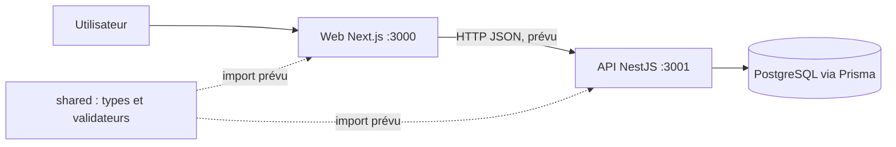
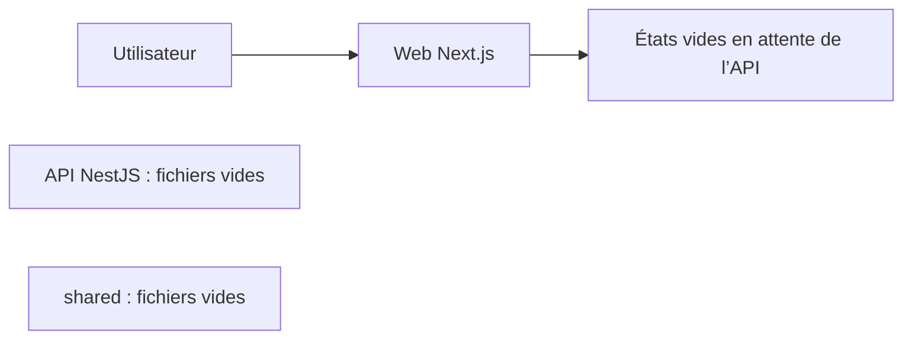

# Architecture PharmaOS

## Résumé

PharmaOS vise une application web connectée à une API métier NestJS, à PostgreSQL via Prisma et à un package de contrats partagés TypeScript/Zod. L’architecture cible est multi-tenant et multi-pharmacies.

Les traits pointillés signalent une intégration attendue, pas une intégration en place.

## État réellement implémenté

Le frontend est le seul composant exécutable actuellement configuré. `api/` ne contient pas de `package.json`, et les fichiers source API, le schéma Prisma, ainsi que les fichiers source de `shared/` sont vides. Il n’y a ni migration, ni seed, ni compose Docker, ni client HTTP fonctionnel.

## Frontend

- Framework : Next.js 15 App Router, React 19, TypeScript.
- Entrée du dashboard : `web/app/(dashboard)/page.tsx`, servie à `/`.
- Layout commun : `web/app/(dashboard)/layout.tsx` et `web/components/dashboard-shell.tsx`.
- Pages authentification : `web/app/(auth)/login/page.tsx` et `register/page.tsx`.
- Liste et formulaire produit : `web/components/products-page.tsx`.
- Styles : `web/app/styles.css`.
- Icônes : SVG internes dans `web/components/icons.tsx`.
- Logo de marque : `web/public/pharmaos-logo.png`, avec transparence, utilisé dans la navigation et les pages d’authentification.
- Aucun jeu de données métier n’est chargé. Le dashboard, l’annuaire fournisseurs, la sélection de pharmacies et les autres modules affichent des états vides.
- Les formulaires d’ajout de produit et de fournisseur ne conservent les éléments qu’en mémoire jusqu’au rechargement.
- Login/register sont des écrans de formulaire sans endpoint ; « Se déconnecter » nettoie les clés locales de jeton prévues et redirige vers `/login`. Aucun jeton/session serveur n’est actuellement délivré.

Le menu de pharmacie est vide jusqu’au branchement des données pharmacies. La propagation du site actif au client API reste à implémenter.

## API et persistance prévues

Les répertoires `api/src/modules/` contiennent des emplacements pour auth, users, tenants, pharmacies, products, inventory, sales, suppliers et reports. Ces fichiers ne sont pas encore implémentés. Le fichier `api/prisma/schema.prisma` est vide. Les conventions d’API, endpoints, erreurs et pagination devront être précisées après le bootstrap.

La cible décrite par les briefs utilise PostgreSQL et Prisma. Redis est explicitement hors du chemin critique MVP.

## Contrats partagés

Les dossiers `shared/types/` et `shared/validators/` contiennent les fichiers prévus pour les contrats auth, pharmacy, user, supplier, product, inventory, sale et report. Ils sont actuellement vides et ne sont pas publiés comme package. Une fois initialisés, ils doivent devenir la source unique des types et validateurs utilisés par l’API et le frontend.

## Sécurité et isolation cible

- Chaque ressource est rattachée à un tenant authentifié.
- Les stocks, ventes et autres données d’exploitation sont également rattachés à une pharmacie.
- Le serveur doit appliquer l’isolation ; masquer des données dans l’interface ne constitue pas un contrôle d’accès.
- Rôles MVP des briefs : `OWNER`, `MANAGER`, `CASHIER`.
- L’authentification, les guards et les contrôles d’accès sont à implémenter avant l’usage de données réelles.

Voir [`CONTRACTS.md`](CONTRACTS.md) pour les champs métier attendus et les décisions encore ouvertes.
